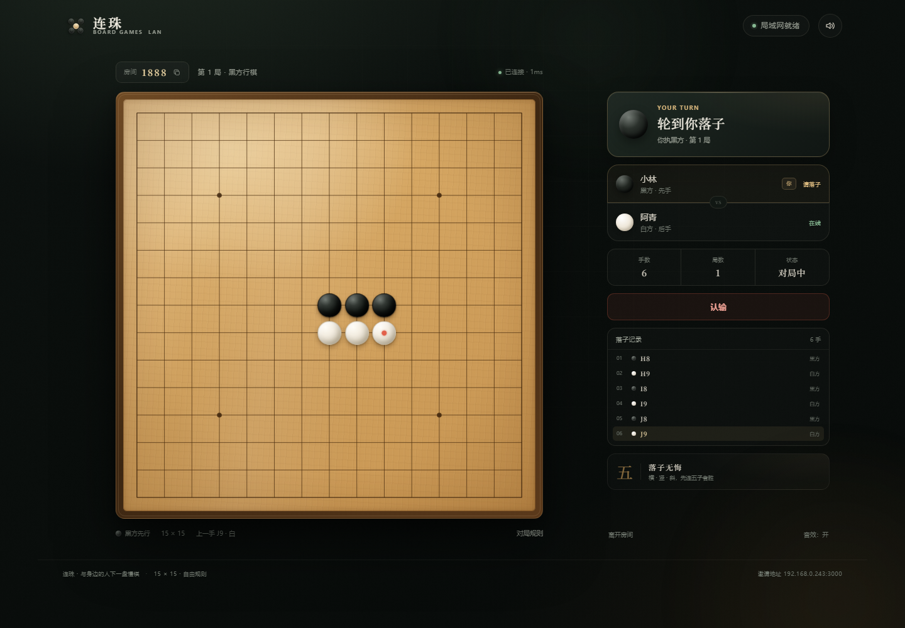
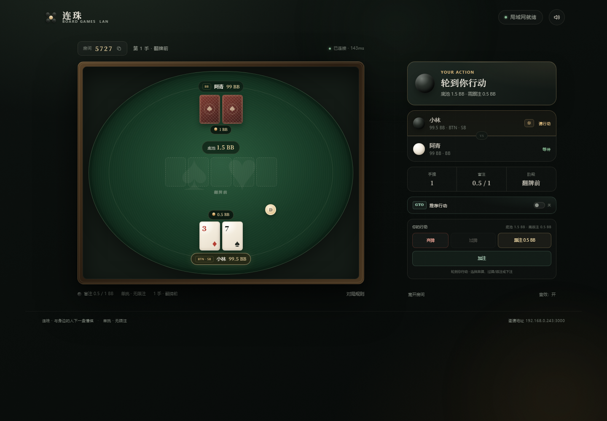
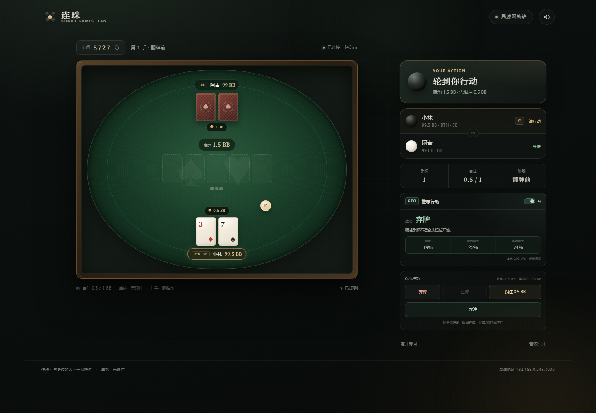

# 连珠 · LAN Board Games

一个零依赖、开箱即玩的双人局域网棋牌桌，内置 **五子棋**、**中国跳棋** 与 **单挑德州扑克**。房主创建房间，把邀请链接发给同一 Wi-Fi 下的朋友，打开浏览器就能开局。








## 特点

- **三种玩法，一套房间系统**：五子棋（15 × 15）、中国跳棋（121 洞六角星）与单挑无限注德州扑克。创建房间时选择玩法。
- **局域网联机**：原生 WebSocket 实时同步，无需注册、无需数据库。
- **开箱即玩**：没有 npm 依赖，只要有 Node.js 18+ 即可启动。
- **中国跳棋连跳**：支持多段连跳，玩家可以随时结束回合；服务端会校验每一跳、阻挡与重复落点。
- **单挑德州扑克**：20 / 50 / 100 / 200 BB 起始筹码可选，0.5 / 1 BB 固定盲注，按钮位每手轮换；支持翻前、翻牌、转牌、河牌、All-in、摊牌、平分底池与自动下一手。
- **右侧 GTO 推荐**：每位玩家可独立开启或关闭。开启后显示本地 GTO 近似建议、模拟胜率、底池赔率与推荐频率，用于行动参考。
- **断线恢复**：刷新页面或短暂断网后，座位保留 90 秒，可自动回到原房间。
- **体验细节**：发牌与下注动画、底牌隐私、摊牌展示、牌型判定、自动下一手、音效、响应式手机布局。

## 快速开始

需要 [Node.js](https://nodejs.org/) 18 或更高版本。

### 方式一：双击启动（Windows）

双击 **[start-game.bat](start-game.bat)**。脚本会启动服务器并自动打开浏览器。

### 方式二：命令行

```bash
npm start
```

启动后终端会显示类似：

```text
本机打开      http://localhost:3000
局域网打开    http://192.168.1.23:3000
```

### 开始联机

1. 房主打开地址，输入昵称，选择「五子棋」「中国跳棋」或「德州扑克」，点击 **创建房间**。选择德州扑克时，还可以选择双方起始筹码为 20 / 50 / 100 / 200 BB。
2. 点击 **复制邀请链接**，把链接发给同一 Wi-Fi 下的朋友。
3. 朋友打开链接、输入昵称，点击 **加入对局**。加入后会自动进入房主选择的玩法与筹码设置。
4. 按对应玩法轮流行动。

如果邀请链接打不开，让朋友直接访问终端里的 **局域网地址**，再输入房主界面上的 4 位房间号即可。

> 手机和电脑需要连接同一个 Wi-Fi。若无法访问，请检查 Windows 防火墙是否允许 Node.js 使用“专用网络”，或临时放行 TCP 端口 3000。部分公共 Wi-Fi 开启了“AP 隔离”，设备之间无法互访。

## 玩法规则

### 五子棋

- 黑方先行，双方轮流在交叉点落子。
- 横、竖、斜任意方向先连成五子者获胜，长连也算胜。
- 棋盘落满仍未分胜负，判为和棋。
- 点击「认输」即判负。

### 中国跳棋

- 双人各执 10 枚棋子，分别占据六角星上下两个相对的三角形阵营。
- 每回合可以走到相邻空位一步，或跳过相邻的一枚棋子落到后面的空位。
- 跳跃可以连续进行，允许中途转向；连续跳跃中可以随时点击「结束回合」。
- 连跳途中不能改为普通走步，也不能重复经过同一位置。
- 率先把自己的全部 10 枚棋子送进对面三角形阵营的一方获胜。
- 跳跃不吃掉棋子；所有棋子都可以被双方跳过。

### 单挑德州扑克

- 单挑无限注德州扑克：双方起始筹码相同，盲注固定为 0.5 / 1 BB，按钮位每手轮换；按钮位同时是小盲，翻前先行动，翻后后行动。
- 每人两张底牌，依次发出翻牌 3 张、转牌 1 张、河牌 1 张，共 5 张公共牌。
- 每轮可过牌、跟注、下注、加注、弃牌或 All-in；下注最低 1 BB，加注最低为一个完整加注额，短码全下除外。
- 用两张底牌与五张公共牌组成最佳 5 张牌比大小；牌型相同则平分底池。
- 一手结束后自动开始下一手；一方筹码清零则本局结束。双方都点击「再来一局」会重置筹码并重新开局。
- 底牌只发送给本人；摊牌时才公开双方底牌。弃牌结束的手牌不会公开对手底牌。

三种玩法的对局结束后，双方都点击「再来一局」即可开始新一局。五子棋与中国跳棋会交换黑白；德州扑克会重置筹码并交换按钮位颜色。

## GTO 推荐

德州扑克界面右侧有一个 **GTO 推荐行动** 开关，默认关闭，每位玩家独立设置：

- 开启后会展开一个小面板，显示建议行动（弃牌 / 过牌 / 跟注 / 下注 / 加注 / All-in）、推荐尺度、简要理由、模拟胜率、底池赔率与推荐频率。
- 翻前使用位置、起手牌强度与筹码深度做近似策略；翻后使用蒙特卡洛模拟估算对随机对手的胜率，再结合底池赔率给出建议。
- 面板只读取你自己可见的底牌与公共牌，不会获取或泄露对手底牌。
- 这是本地运行的 GTO 近似参考，不是商业级 solver，也不依赖任何外部模型或 API；仅供娱乐与学习。

## 配置

默认监听 `0.0.0.0:3000`，对局域网开放。

```powershell
# Windows PowerShell：换一个端口
$env:PORT=8080
npm start

# 只允许本机访问（不推荐用于联机）
$env:HOST='127.0.0.1'
npm start
```

邀请链接会自动使用当前浏览器地址生成；如果房主从 `localhost` 打开，会优先使用服务端检测到的第一个局域网 IPv4 地址。多网卡（例如同时开启 VPN）时，启动终端里会列出全部可用地址。

## 项目结构

```text
.
├─ server.js                 # HTTP 静态服务 + 房间/对局逻辑 + 手写 WebSocket
├─ public/
│  ├─ index.html             # 大厅、房间、五子棋/跳棋/扑克界面
│  ├─ styles.css             # 视觉与响应式布局
│  ├─ app.js                 # 客户端状态机、联机交互、棋盘/牌桌渲染
│  ├─ checkers-core.js       # 跳棋共享核心（服务端与浏览器共用）
│  ├─ poker-core.js          # 扑克牌力、蒙特卡洛胜率与本地 GTO 建议
│  └─ favicon.svg
├─ test/
│  ├─ smoke.js               # 房间、棋局、扑克、重连等集成测试
│  ├─ visual.js              # 五子棋 / 跳棋 Chrome 截图与交互检查
│  └─ poker-visual.js        # 德州扑克 Chrome 截图与 GTO / 摊牌检查
├─ start-game.bat
└─ package.json
```

房间只保存在内存中，服务器重启后会清空。服务器不保存任何账号或对局数据。

## 测试

```bash
npm test
```

集成测试覆盖：静态页面、路径穿越防护、五子棋创建/加入、落子同步、五连判胜、终局保护、黑白互换、认输、离开房间、断线重连；中国跳棋的 121 洞棋盘、合法步/跳、连跳、胜负、房间同步和再来一局；以及德州扑克的牌力评估、GTO 建议、发牌与底牌隐私、全下摊牌、筹码清零、再来一局、弃牌结算、自动下一手和起始筹码选项，共 22 项。

> `npm test` 使用 Node 内置的 WebSocket 客户端，需要 Node.js 22 或更高版本；游戏服务器本身在 Node.js 18+ 即可运行。

`test/visual.js` 与 `test/poker-visual.js` 是开发时使用的 Chrome DevTools Protocol 检查脚本，默认连接 `http://127.0.0.1:3000`，生成截图到 `artifacts/`。普通玩家不需要运行它们。

## 说明

- 这是一个面向家庭、宿舍、小型办公室局域网的小游戏，没有做公网部署所需的鉴权、限流与 TLS。请勿直接暴露到公网。
- 4 位房间号只用于区分私人房间，不具备安全防护能力。
- 服务端是唯一裁判：轮次、走法、连跳路径、发牌、下注、摊牌与筹码结算都由服务端校验。
- GTO 面板是本地近似策略，不保证与商业 GTO solver 的输出一致。
